

 

**Free for personal use &nbsp;·&nbsp; 100% local &nbsp;·&nbsp; No accounts &nbsp;·&nbsp; No telemetry**

---

## Stop guessing at the Auction House

Auctionator already records every price you scan. **WoW AH Watcher turns that pile of numbers into decisions.** It reads your own scans, compares today's price with what an item *really* sells for, and tells you in plain language what is worth buying, what is worth crafting, and what to leave alone. It also tells you honestly when its information is old.

It runs quietly on your own PC, opens in your browser, and stays out of the game. Nothing is uploaded, ever.

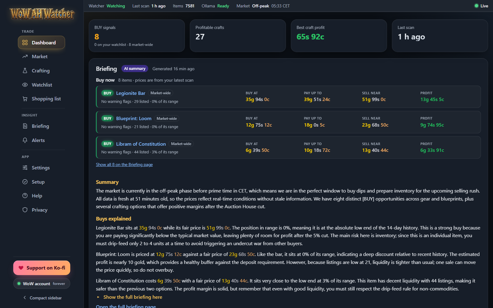
 The dashboard: BUY signals, your best craft and a written briefing of the latest scan.

---

## What it does for you

### Finds the real bargains
Every item from your latest scan gets a signal: **BUY**, **SELL-HOLD** or **WATCH**. A BUY means the price is well below what the item usually sells for, it still makes a profit after the Auction House cut, and there is enough history and supply to trust it. Items that are **Thin** (too few listings), **Old price** (the item's price is old), **Volatile** (prices swing too much) or **Falling** (the last few days sit well below the days before) are never marked BUY, so a one-listing fluke or a price that is still dropping never shows up as a "deal".

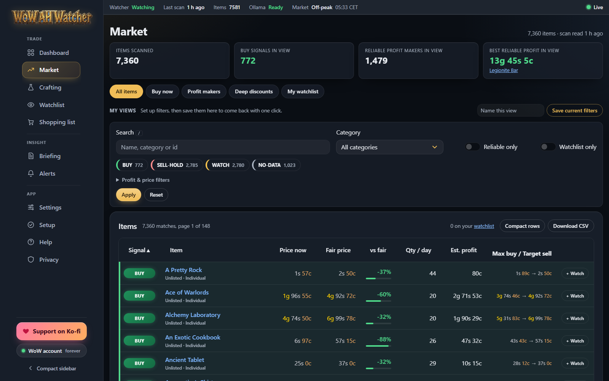
 Market: search and filter thousands of items, jump to presets like <i>Buy now</i> or <i>Deep discounts</i>, and save your own views.

### Shows the true profit of every craft
Crafting is costed from the recipes **your characters actually know**. Every material is priced at the cheaper of its Auction House price and its vendor price, the 5% Auction House cut is taken off, and you see the net profit and margin. A vendor price only counts when the vendor has **unlimited stock**, so limited-stock items are never treated as always buyable. Reputation discounts are already in the price Auctionator saved. Vendor-bought materials carry a **Vendor** label, and crafts your characters cannot make are flagged. If a price is missing, the craft says **"price unknown"**. It never invents a total. Search by name, or press **Show all**, to find any priced craft, not just the top few.

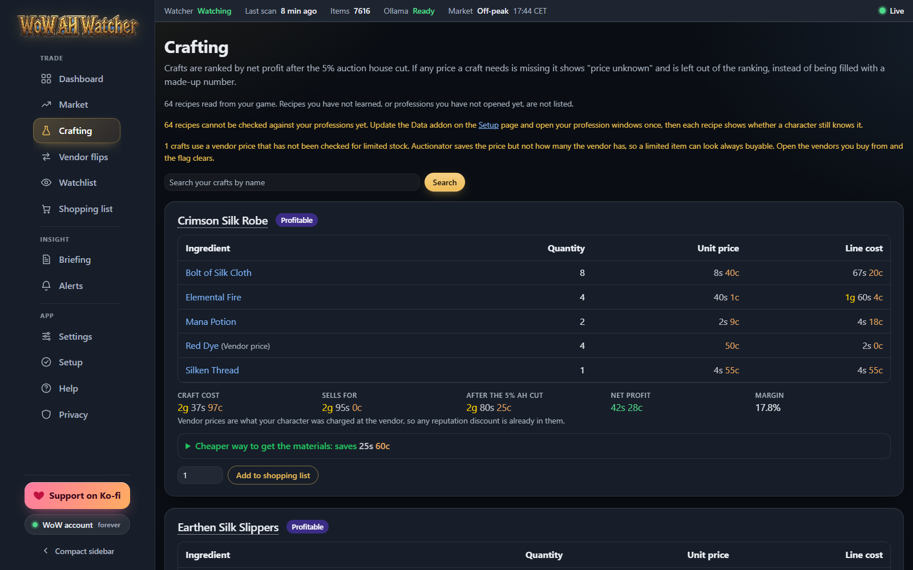
 Crafting: every ingredient, the real cost, and the profit after the Auction House cut.

### Spots flips between the Auction House and vendors
The **Vendor flips** page lists items that are worth more somewhere else than where they are sold, in both directions: items you can **buy on the Auction House for less than a vendor pays**, and items a **vendor sells for less than they fetch on the Auction House** after the 5% cut. Every price comes from your own scan or your own game, never a guess. Auctionator does not save how many items are listed or whether a vendor has limited stock, so the page tells you when stock is not confirmed, leaves out old prices and shows how many it skipped. Check the listings before you buy.

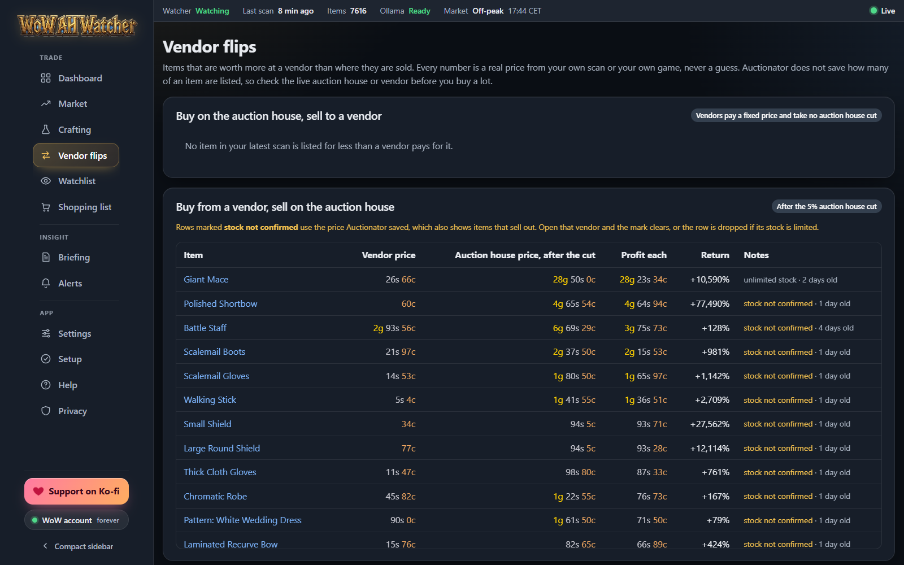
 Vendor flips: both directions, with stock and price age flagged.

### Plans your whole shopping trip
Add the crafts you plan to make and how many of each. You get **one combined "what to buy" list**, and a materials tree that compares buying a part with crafting it yourself, with the savings spelled out.

 Shopping list: one list for every material, and where crafting a part beats buying it.

### Shows what you own, and what it is worth
The **My items** page lists what every character carries in their bags and bank, what sits in the warband bank, and what is listed on the Auction House, valued at the lowest price in your latest scan. Each item carries its market signal, so you can see at a glance which of your stock is at a sell price, which of your auctions have been undercut, and what you hold in total. Every place shows how old its scan is, and items with no price are counted separately instead of guessed. It needs the small Data helper addon, which the guided setup installs.

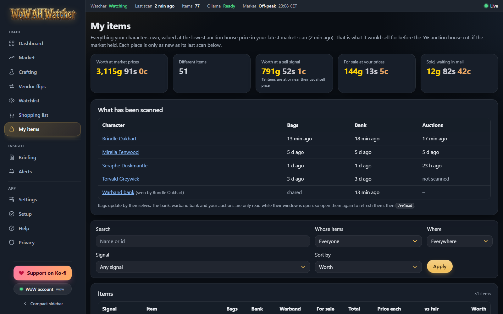
 My items: everything your characters own and have listed, valued at market prices with live signals.

### Tells you the moment a deal appears
A live **Alerts** feed announces each new BUY deal once, with a badge in the sidebar so you notice without staring at the page. Prefer your phone? Add your own **Discord webhook** and the same alerts arrive in a private channel.

 Alerts: every new deal, announced once, with the price to stay under.

### Explains every price
Each item page charts its price history and lists the notable days. Every figure has a plain definition: the **Typical range** is the middle 80% of daily prices, so one spike cannot distort it; **Cheaper than** is the share of days in the window that were dearer than today's price; and the **sell target** stays close to the item's usual daily low, never more than 25% above it. The same definitions are in the app's Help.

 Item page: the chart, the fair price, and the reason behind the signal.

### Writes you a briefing
After each scan you get a short, readable briefing: what to buy now, why, and what to watch. It is built by fixed rules from your data, so it always works. If you run [Ollama](https://ollama.com) on your PC, a local AI can rewrite it as a flowing summary in the style you choose (**Coach**, **Quick flip**, **Crafter** or **Cautious**), and you can add your own notes ("more players reached this skill since launch, so supply is growing") that the AI weighs against the numbers. You watch the summary being written, with live progress, and can stop it at any time. A burst of scans gives one briefing, not a pile of them. Every figure the AI quotes is checked against your data first; a summary that does not match is discarded, the verified briefing is shown, and the page says why. You can also read the rejected text, and a small rounding such as "20g" for a price is noted instead of throwing the whole summary away. The AI runs **on your machine**, so your data stays yours.

 Briefing: a written summary of the latest scan, in the style you pick, with your own notes to steer it.

### Keeps your private details out of sight
Turn on **Streamer mode** with one switch and everything personal is blurred: character and account names, folders on your PC, your gold, the items you hold and your Discord webhook. Names in drop-down lists are replaced by Character 1, 2 and so on. Market prices, signals and the watchlist stay visible, so you can stream or share a screenshot safely. Under Settings you can also choose **Show my items**, which keeps names, folders and secrets blurred but shows your item lists. It is free for everyone.

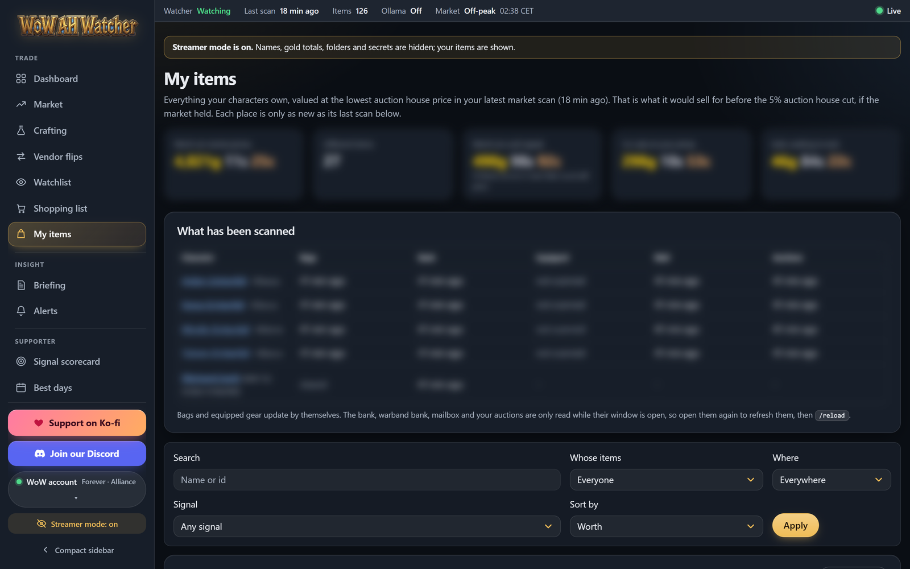
 Streamer mode: hide names, folders and gold, and choose whether your items stay visible.

---

## Supporter features

The whole app is free. Supporters (a coffee on Ko-fi unlocks it) can sign in once on the app's Supporter page to unlock a few extras:

- **Trade advisor:** turns your bags, bank and mail and the market into a plan of what to sell, buy, craft and keep.
- **Profit ledger and goals:** what you earned over 7 days, 30 days and in total, per item and week by week, with a weekly or monthly gold goal.
- **Best days:** a weekday heat map of when prices are usually lowest and highest, for the whole market, your items and your watchlist.
- **Signal scorecard:** replays the Buy signal over your own history to show how often it was right.
- **Remote dashboard:** a read-only dashboard for your home network that adapts to phones, tablets and PCs.

Signing in is optional and only confirms that you are a supporter. Everything that was free stays free.

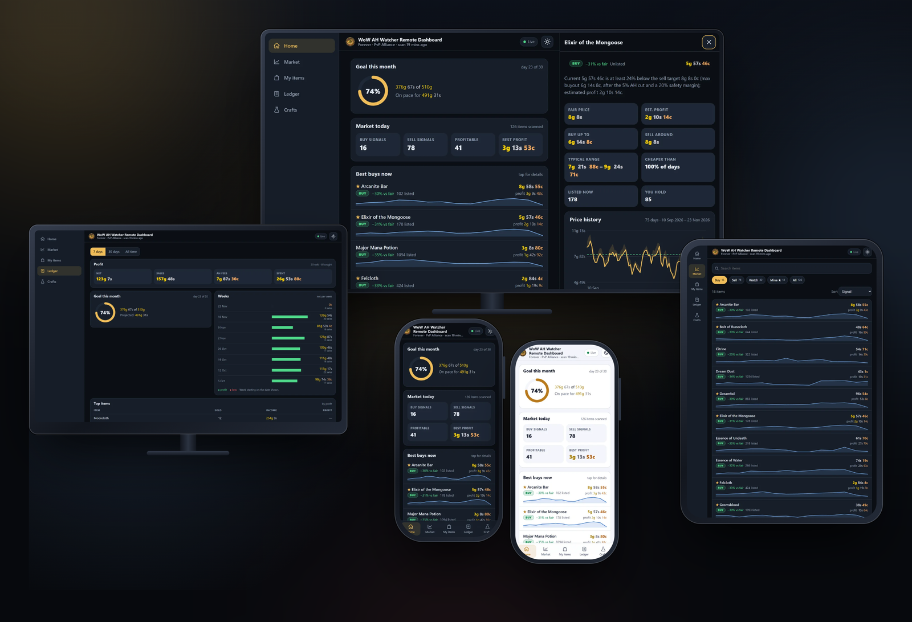
 Remote dashboard: pair a phone, tablet, laptop or TV once with a short PIN. It is read-only, adapts to the screen and follows your light or dark theme.

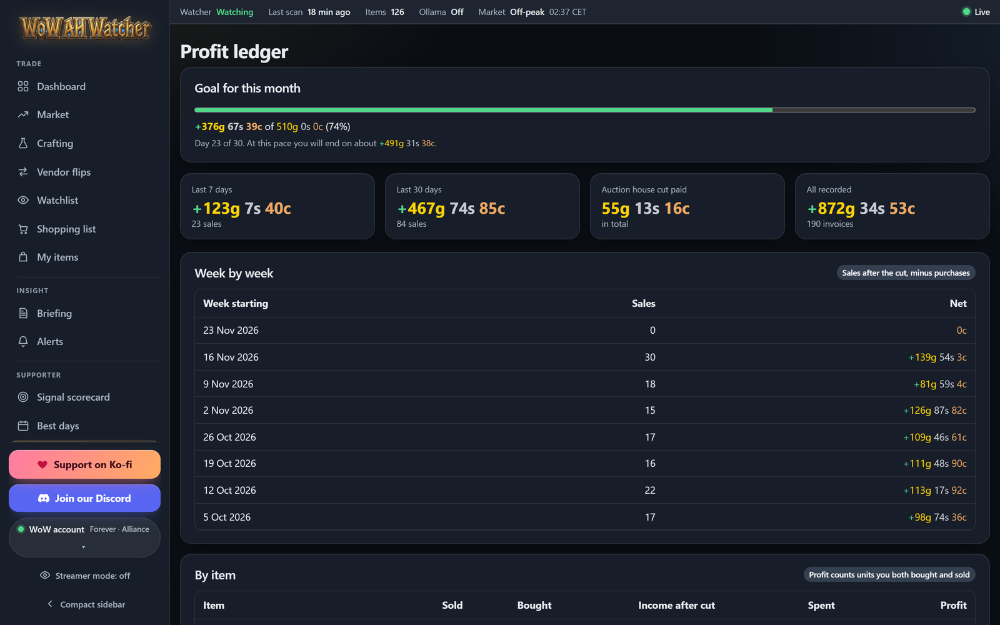
 Profit ledger: your real sales and purchases, a monthly goal with a pace line, and the true profit per item.

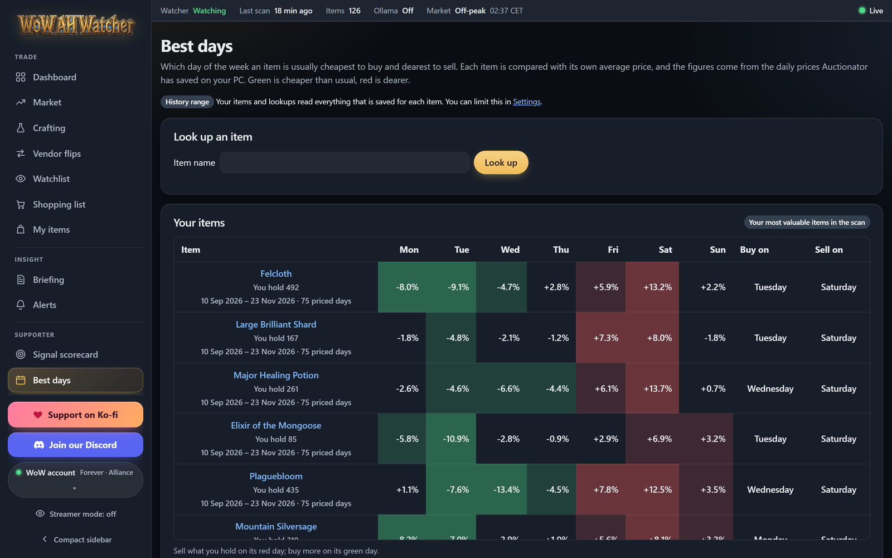
 Best days: when each item is usually cheapest and dearest, with your watchlist on top.

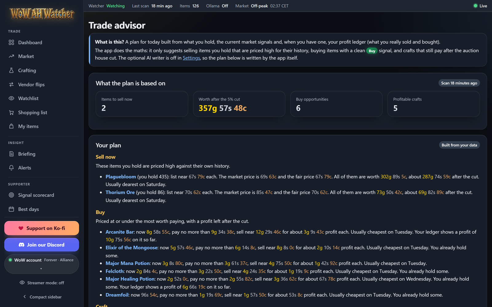
 Trade advisor: a plan for today built from what you hold and the current market.

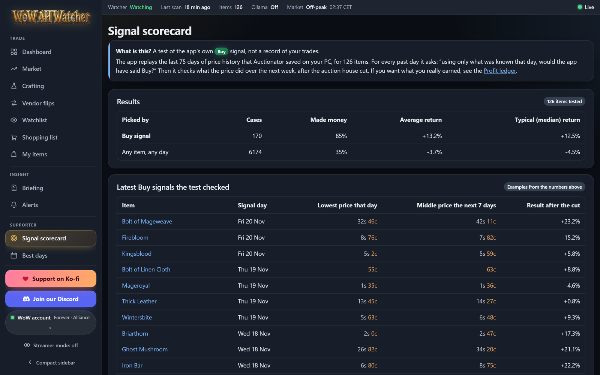
 Signal scorecard: how often the Buy signal really paid off, replayed over your own history.

All screenshots use made-up characters and prices.

---

## Everything else in the box

| | |
|---|---|
| **Watchlist** | Follow the items you care about. Suggestions are built from your own market history, never from a built-in list. |
| **Every game version** | Retail, WoW: Forever, Burning Crusade Classic Anniversary, Mists of Pandaria Classic and Classic Era. A market switcher in the sidebar picks the market, and each market keeps its own history. |
| **Backup and restore** | One zip with your settings, lists and price history, and a guided way to put it back. |
| **Saved Market views** | Save a set of filters under a name and reopen it with one click. |
| **CSV download** | Take the whole market table into a spreadsheet. |
| **Honest freshness labels** | The age comes from Auctionator's own scan time. Fresh (under an hour), aging, stale and very old data are labelled, and old prices never pose as a deal. |
| **Guided setup** | Finds your WoW account, helps you install the two small helper addons (item names, vendor prices and recipes), and tells you exactly what is missing. |
| **Gold, silver and copper** | Every price uses the in-game coin colours, everywhere in the app. |
| **Runs like a normal Windows app** | No console window. It opens in your browser, and a tray icon lets you open, restart or quit it, and start it with Windows. |
| **Item names for every item** | The Names helper addon records real item names and what vendors pay, so prices are not shown as bare numbers. |
| **Built-in Help** | A full guide to every page, the signals, the glossary and the in-game commands. |

---

## Your data never leaves your PC

- Everything is calculated **locally**. There are no accounts, no telemetry, no analytics and no third-party scripts.
- The app only talks to **your own local Ollama**, to a **Discord webhook you add yourself**, and to **GitHub** to ask for the newest release number so it can offer updates (you can turn that off in Settings). If you choose to sign in as a supporter, it also contacts the project's supporter sign-in, only to confirm that you are a supporter. Nothing about you or your data is sent. Updates are never installed without you pressing **Update now**.
- Your WoW account name is hidden in the sidebar by default, so you can share a screenshot or stream without leaking your Battle.net number.

---

## Requirements

| | |
|---|---|
| **Windows 10 or 11** | 64-bit. No administrator rights needed. |
| **World of Warcraft** | Installed, and logged in at least once. |
| **[Auctionator](https://www.curseforge.com/wow/addons/auctionator)** | The Forever version, enabled on the character you play, with at least one Auction House scan. It is a separate addon and is not included. |
| **[Ollama](https://ollama.com)** *(optional)* | Only for the AI-written briefing. Everything else works without it. |

## Get started in a few minutes

1. **[Download the latest release](https://github.com/nanidev/wowahwatcher/releases/latest)** and run `WoWAHWatcher-Setup-<version>.exe`. (Prefer no installer? Download the `.zip`, unzip it anywhere and run `WoWAHWatcher.exe`.)
2. The dashboard **opens in your browser** by itself. Click **Set up your WoW account** and follow the guided setup.
3. In game: open the Auction House and let Auctionator scan, open your profession windows once, then log out or type `/reload`. The app notices within seconds and fills in.

> **Windows SmartScreen:** the first build is not code-signed yet, so Windows may say *"Windows protected your PC"*. Click **More info**, then **Run anyway**. Every download comes with a `.sha256` file so you can check it is untouched.

---

## 💛 Support the project

**WoW AH Watcher is free, and it is built and maintained by one person.** If it saved you gold, found you a flip, or just made the Auction House less of a chore, a coffee helps keep it going and pays for new features and fixes.

Supporting is completely optional, and the app works exactly the same without it. Bug reports and ideas are welcome too: please [open an issue](https://github.com/nanidev/wowahwatcher/issues).

---

## Licence and disclaimer

WoW AH Watcher is proprietary software, copyright &copy; 2026 nanidev. All rights reserved. It is free for personal, non-commercial use. Copying, redistributing, modifying, reverse engineering or selling it is not allowed. See [LICENSE.txt](LICENSE.txt).

Signals are decision support, not financial advice. They only know your last scan.

World of Warcraft is a trademark of Blizzard Entertainment, and Auctionator belongs to its authors. WoW AH Watcher is an independent companion tool and is not affiliated with or endorsed by Blizzard Entertainment or the Auctionator authors.
